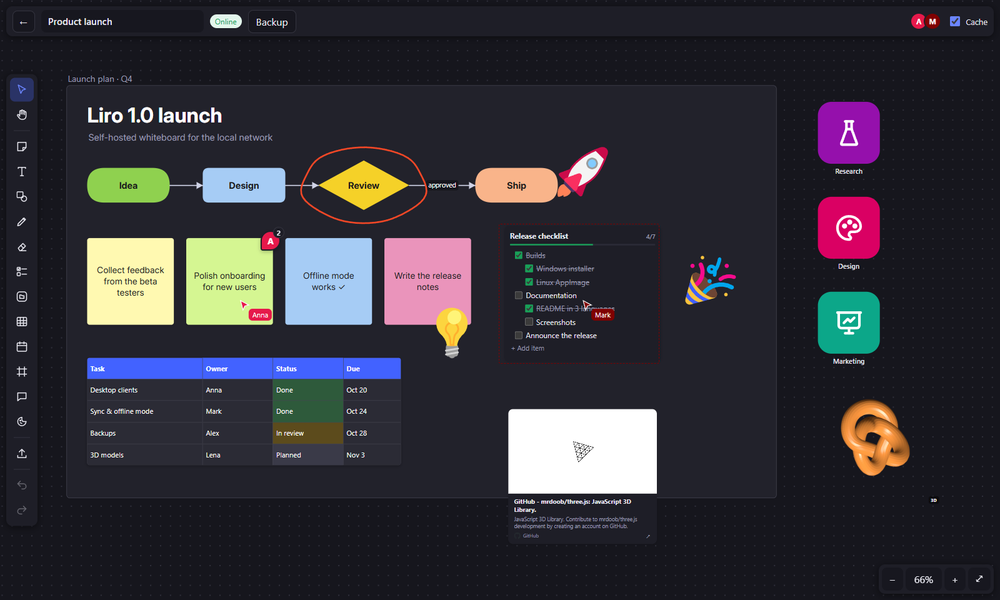
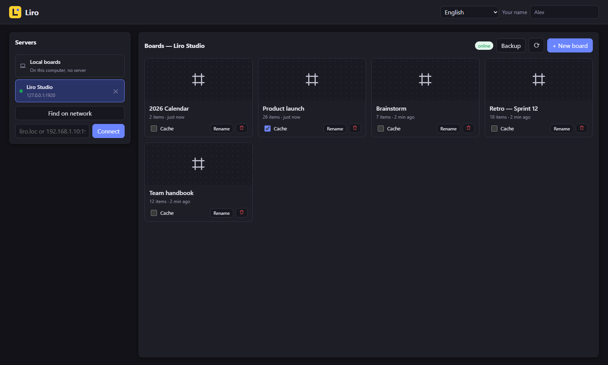
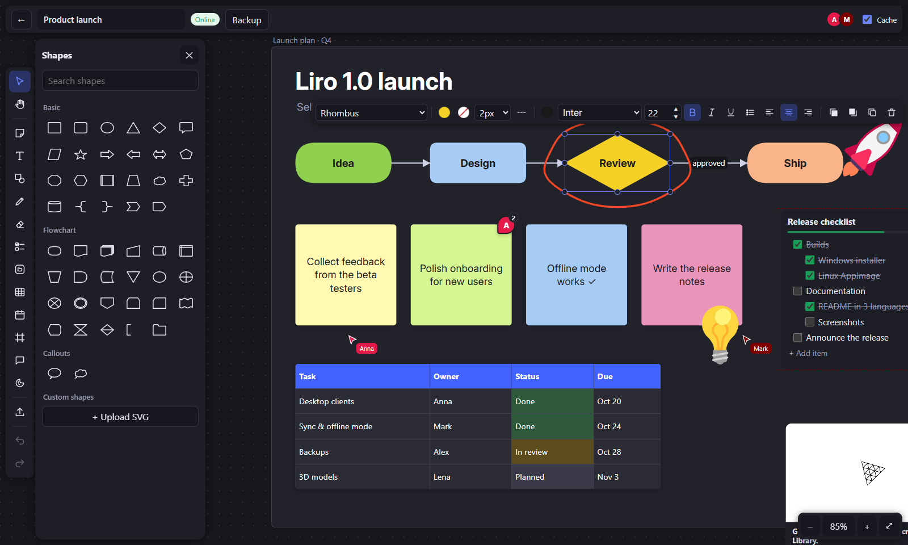
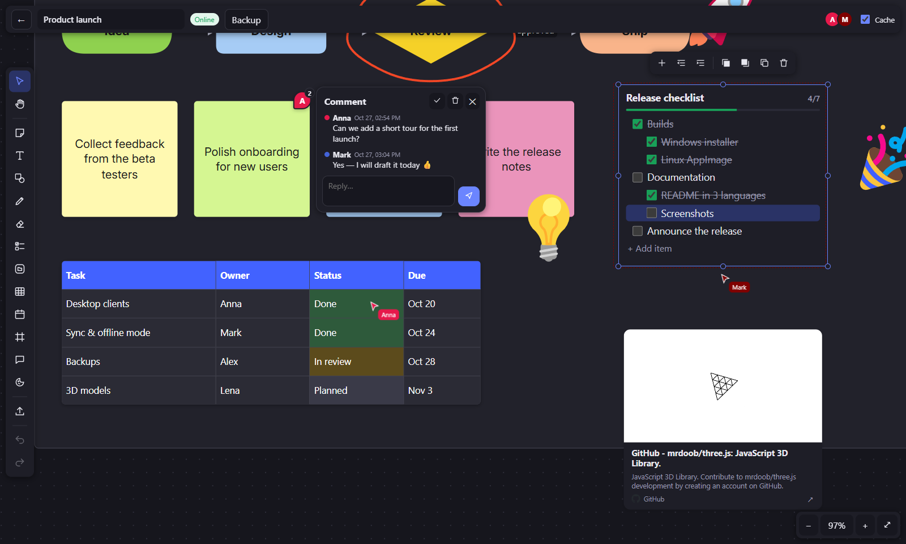
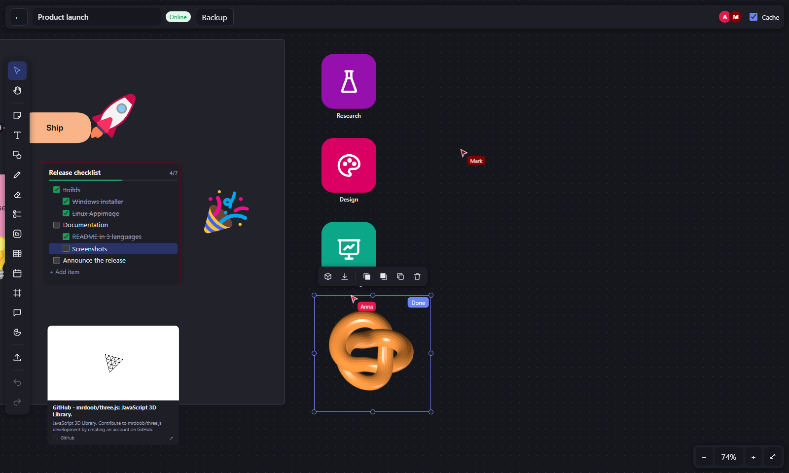
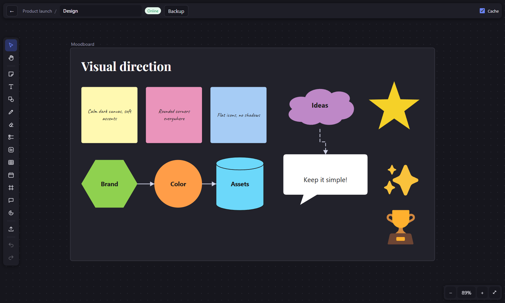
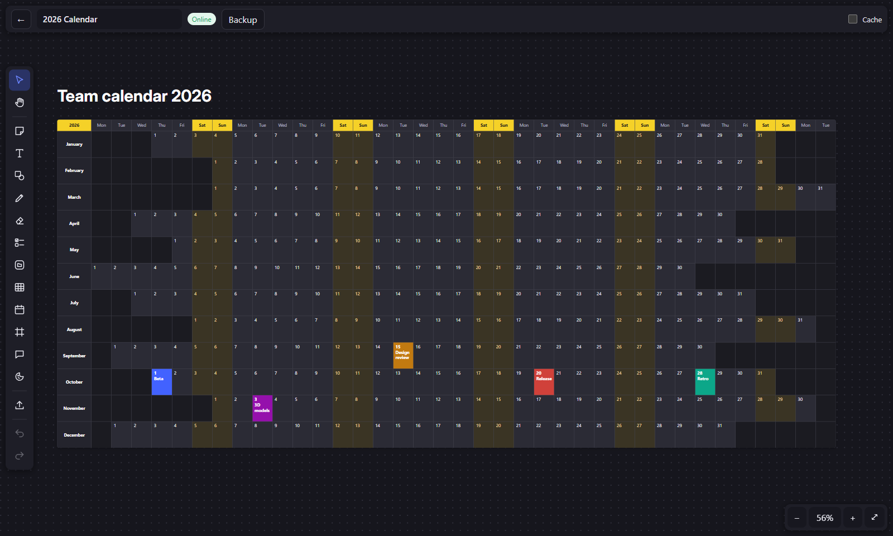

<div align="center">


# Liro

**Доска для совместной работы в вашей локальной сети.**
Вдохновлена Miro и Milanote, но доски живут на вашем сервере, работают без интернета и не требуют аккаунтов.

[English](README.md) · **Русский** · [中文](README.zh-CN.md)




</div>

## Зачем Liro

- **Ваша сеть — ваши данные.** Один небольшой сервер на Node.js под Linux или Windows; доски и файлы — обычные папки на его диске.
- **Работа вместе в реальном времени.** Все в локальной сети правят одну доску и видят курсоры и выделения друг друга.
- **Офлайн в первую очередь.** Закешируйте доску на компьютере и работайте, даже когда сервер выключен: когда он вернётся, Liro спросит, как объединить изменения.
- **Без аккаунтов, облака и слежки.** Откройте приложение, выберите найденный в сети сервер и начинайте.

## Возможности

| | |
|---|---|
| 🗒️ **Контент** | Стикеры, текст с маркированными и нумерованными списками, 48 фигур (основные, блок-схемы, выноски) и свои SVG-фигуры, линии и стрелки (прямые, ломаные, кривые) с подписями и привязкой к фигурам, карандаш со сглаживанием, фреймы |
| ✅ **Структура** | Многоуровневые списки задач с перетаскиванием и прогрессом, таблицы, календарь на любой год, комментарии с обсуждением, вложенные доски с иконками и «хлебными крошками» |
| 🖼️ **Медиа** | Изображения, видео, аудио, любые файлы, карточки ссылок с превью (картинки хранятся на сервере), стикер-паки, 3D-модели (glTF/GLB, FBX, OBJ+MTL, STL, PLY, 3MF, DAE) с вращением |
| 🎨 **Оформление** | Цветовой круг с пресетами, прозрачность заливки и линий, настройка пунктира, 23 встроенных шрифта и загрузка своих, магнитные направляющие, выравнивание и распределение |
| 👥 **Совместная работа** | Правки в реальном времени, курсоры и выделения участников, бесконфликтное слияние одновременных правок, отмена и повтор |
| 📴 **Офлайн и локально** | Кешированные доски работают без сервера; новые доски можно создавать офлайн; «Локальные доски» хранятся только на вашем компьютере и переносятся на сервер, когда нужно |
| 🗄️ **Администрирование** | Бэкапы всего сервера, отдельной доски или локальных досок; контроль свободного места; удалённые файлы стираются через сутки; скрипты установки, обновления и переноса хранилища для Linux и Windows |
| 🌍 **Языки** | Интерфейс на русском и английском (по языку системы) |

## Скриншоты

<table>
  <tr>
    <td width="50%"><br><sub><b>Серверы и доски.</b> Найденные в сети серверы, локальные доски, кеширование и бэкапы.</sub></td>
    <td width="50%"><br><sub><b>Библиотека фигур.</b> Основные фигуры, блок-схемы, выноски и свои SVG.</sub></td>
  </tr>
  <tr>
    <td><br><sub><b>Вместе.</b> Комментарии, многоуровневые списки, таблицы и курсоры коллег.</sub></td>
    <td><br><sub><b>3D-модели.</b> Вращайте модель прямо на доске — ракурс запоминается.</sub></td>
  </tr>
  <tr>
    <td><br><sub><b>Вложенные доски.</b> Доски внутри досок с навигацией.</sub></td>
    <td><br><sub><b>Календарь на год.</b> Большой календарь на любой год из редактируемой таблицы.</sub></td>
  </tr>
</table>

## Как начать

### 1. Запустите сервер

<details open>
<summary><b>Linux</b> (systemd)</summary>

```bash
tar xzf liro-src.tar.gz && cd liro
sudo bash deploy/install.sh
```

Скрипт при необходимости ставит Node.js 22, копирует сервер в `/opt/liro`, хранит доски в `/var/lib/liro`,
настройки — в `/etc/liro/liro.env`, запускает службу `liro` и открывает порты в брандмауэре.

```bash
sudo bash deploy/update.sh                              # обновить до новой версии, доски и настройки сохраняются
sudo bash deploy/configure.sh --data /mnt/storage/liro  # перенести хранилище досок
journalctl -u liro -f                                   # журнал
```
</details>

<details>
<summary><b>Windows</b> (PowerShell от имени администратора)</summary>

```powershell
powershell -ExecutionPolicy Bypass -File deploy\windows\install.ps1 -DataDir D:\LiroData
powershell -ExecutionPolicy Bypass -File deploy\windows\update.ps1
powershell -ExecutionPolicy Bypass -File deploy\windows\configure.ps1 -DataDir E:\LiroData
powershell -ExecutionPolicy Bypass -File deploy\windows\uninstall.ps1
```

Сервер работает как задача планировщика «Liro Server» (запуск вместе с Windows, перезапуск при сбое).
Настройки: `C:\ProgramData\Liro\liro.env`, журнал: `C:\ProgramData\Liro\logs\liro.log`.
</details>

<details>
<summary><b>Без установки</b></summary>

```bash
cd server && npm install && npm start
```
</details>

Доска доступна по адресу `http://<IP-сервера>:1919` — в любом браузере или в десктопных клиентах.

### 2. Установите клиент

Скачайте из [Releases](../../releases/latest):

| Платформа | Файл |
|---|---|
| Windows (установщик) | `Liro-<версия>-win-x64.exe` |
| Windows (портативная) | `Liro-<версия>-portable.exe` |
| Linux | `Liro-<версия>-linux-x86_64.AppImage` (`chmod +x`, нужен `libfuse2`) |

Клиент сам находит серверы Liro в сети (UDP-broadcast и mDNS). Можно подключиться и по адресу:
`liro.loc`, `192.168.1.10` или `192.168.1.10:1919`.

### 3. По желанию: имя `liro.loc`

Клиентам оно не нужно, а браузерам — да. Добавьте в роутере DNS-запись `liro.loc → <IP-сервера>`
(для dnsmasq: `server=/loc/<IP-сервера>` и встроенный DNS-ответчик `LIRO_DNS=1`) или строку
`<IP-сервера> liro.loc` в файл `hosts` на каждом компьютере.

## Работа без сети

- Включите **«Кешировать»** у доски: доска и все её файлы хранятся на компьютере и синхронизируются с сервером.
- Если сервер недоступен, кешированная доска полностью редактируется. Изменения копятся в очереди на диске и переживают перезапуск.
- Когда сервер вернётся, Liro спросит: **обновить доску на сервере**, **сохранить вашу версию копией** или **отменить ваши изменения**.
- Новые доски можно создавать и без сервера — они загрузятся, когда он появится.
- **Локальные доски** живут только на вашем компьютере (или в браузере), их можно в любой момент перенести на сервер.

## Бэкапы

Кнопка **«Бэкап»** есть в трёх местах:

| Где | Что сохраняет | Куда восстанавливает |
|---|---|---|
| Список досок сервера | Все доски с файлами, загруженные шрифты, фигуры, иконки и стикер-паки | На этот сервер |
| «Локальные доски» | Все локальные доски, локальные шрифты/фигуры/иконки и настройки клиента | В локальные доски |
| Открытая доска | Эту доску вместе с вложенными и файлами | Туда, где открыта доска |

Бэкап — обычный архив `.tar`, имя которого говорит, что внутри (`Liro-server-…`, `Liro-board-…`, `Liro-local-…`),
с файлом `manifest.json`. При восстановлении вы выбираете: заменить существующие доски и файлы или добавить только недостающее.

## Настройки

Настройки сервера — переменные окружения, обычно в файле `liro.env`:

| Переменная | По умолчанию | Описание |
|---|---|---|
| `LIRO_NAME` | `Liro (<имя компьютера>)` | Имя сервера в клиентах |
| `LIRO_PORT` | `1919` | Порт HTTP/WebSocket (обнаружение по UDP — на том же номере) |
| `LIRO_EXTRA_PORTS` | — | Дополнительные порты HTTP, например `80` для `http://liro.loc` |
| `LIRO_DATA` | `server/data` | Доски, медиа, шрифты, фигуры, иконки, стикеры |
| `LIRO_HOSTNAME` | `liro.loc` | Имя для встроенного DNS-ответчика |
| `LIRO_DNS` | `0` | Встроенный DNS-ответчик на порту 53 |
| `LIRO_MDNS` | `1` | Объявлять сервер через mDNS |
| `LIRO_MAX_UPLOAD_MB` | `2048` | Максимальный размер одного файла |
| `LIRO_DISK_WARN_GB` / `LIRO_DISK_BLOCK_GB` | `10` / `5` | Предупреждение о месте / только редактирование |
| `LIRO_MEDIA_GRACE_HOURS` | `24` | Через сколько часов удаляются неиспользуемые файлы |
| `LIRO_CONFIG` | `/etc/liro/liro.env`, `%ProgramData%\Liro\liro.env` | Файл настроек |

Порты: `1919/tcp` (веб, API), `1919/udp` (обнаружение), `5353/udp` (mDNS), по желанию `80/tcp` и `53/udp`.

**Стикер-паки:** положите папку с картинками в `<данные>/stickers/<пак>/` (по желанию `pack.json` с `{"name": "…"}`).
Пак появится у всех клиентов без перезапуска.

## Горячие клавиши

| Клавиша | Действие | Клавиша | Действие |
|---|---|---|---|
| `V` | Выделение | `H` / `Пробел` | Рука |
| `N` | Стикер | `T` | Текст |
| `R` / `O` | Прямоугольник / Овал | `L` / `A` | Линия / Стрелка |
| `P` | Карандаш | `E` | Ластик |
| `K` | Список задач | `G` | Таблица |
| `B` | Вложенная доска | `F` | Фрейм |
| `C` | Комментарий | `Del` | Удалить |
| `Ctrl+Z` / `Ctrl+Shift+Z` | Отменить / Повторить | `Ctrl+C` / `V` / `D` | Копировать / Вставить / Дублировать |
| `Shift+1` | Показать всё | `Alt` при перетаскивании | Без магнитных направляющих |

## Сборка из исходников

```bash
cd server && npm install && npm test          # сервер и 15 сквозных тестов
cd client && npm install && npm run dist:win   # установщик и портативная версия для Windows (на Windows)
cd client && bash build-linux.sh               # AppImage для Linux (на Linux или в WSL)
```

```
server/   сервер на Node.js: HTTP API, синхронизация по WebSocket, хранение, обнаружение, бэкапы
web/      интерфейс доски, общий для браузера и десктопного клиента
client/   десктопный клиент на Electron: поиск серверов, локальный кеш, офлайн-режим
deploy/   скрипты установки, обновления и настройки для Linux и Windows
```

## Лицензия

Liro распространяется по [лицензии MIT](LICENSE). Встроенные шрифты, иконки, стикеры и библиотеки сохраняют
свои лицензии — см. [THIRD_PARTY_NOTICES.md](THIRD_PARTY_NOTICES.md).

Liro — независимый проект и не связан с Miro или Milanote; их названия — товарные знаки соответствующих владельцев.
